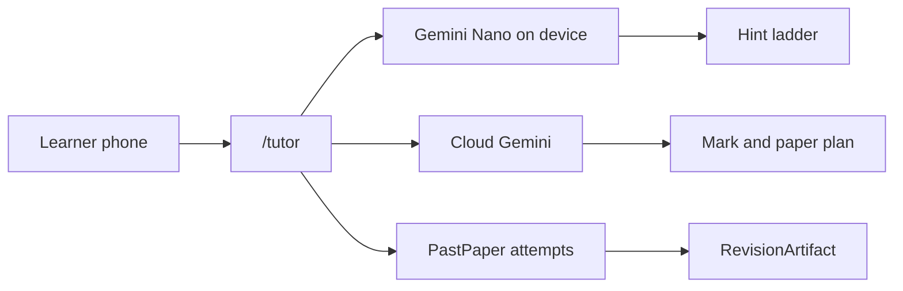

# South African R-12 Education Platform

Production-grade monorepo for a glassmorphic, low-latency curriculum platform with SSR/SSG pages and a secure API.

SCHOOL Hybrid Tutor is for Grade 10–12 CAPS learners on expensive mobile data. Hints prefer Gemini Nano on the phone, so a weak signal still gets a private answer. Long answers and PDF papers fall back to cloud Gemini. The phone layout keeps the main action in the thumb zone, accepts a camera photo, and can be installed as a PWA.



## Built during #BuildHybridAI (from 11 Nov 2026)

New in this branch: `/tutor`, Firebase AI Logic hybrid inference, skill map, timed sittings, revision notes, family read-only link, mobile camera flow, and the publication safety notes in `docs/PUBLICATION_SAFETY.md`. The rest of the monorepo (lessons, past-paper catalogue, API, mobile app shell) was already here. The Expo app opens `/tutor` from Practice. It does not embed a second model.

Setup for the tutor, judge notes, and the demo script are in `docs/HACKATHON.md`.

## Tech Stack
- Web: Next.js (App Router, SSR/SSG)
- API: Fastify + PostgreSQL + Redis + BullMQ
- Shared: TypeScript + Zod schemas

## Node Version
This repo targets Node 18/20 LTS. Node 22+ may warn or fail in some dependencies.

Recommended options:
- Volta: `volta pin node@20.11.1`
- nvm-windows: `nvm install 20.11.1` then `nvm use 20.11.1`

The repo includes `.nvmrc` for convenience.

## Local Dev (Quick Start)
### Prerequisites
- Node.js 18 or 20 LTS
- npm 9+
- Docker Desktop (for Postgres/Redis)

### 1) Create env file
From the repo root:
```bash
cp .env.example .env
```
If you are using PowerShell:
```powershell
Copy-Item .env.example .env
```
The default `POSTGRES_PORT` is set to 5433 to avoid conflicts with local Postgres installs.

### 2) Start dependencies (Postgres + Redis)
Run this from the repo root (Git Bash uses `docker compose`, not `docker-compose`):
```bash
docker compose up -d postgres redis
```

### 3) Install dependencies
```bash
npm install
```

### 4) Run migrations
```bash
npm run db:migrate
```

### 5) Start web + api
```bash
npm run dev
```

- Web: http://localhost:3000
- API: http://localhost:4000
- API health: http://localhost:4000/health

## Scripts
- `npm run dev` - web + api
- `npm run build` - production build
- `npm run lint` - linting
- `npm run check:lesson-boundary` - enforce canonical lesson endpoint and route boundaries
- `npm run typecheck` - TypeScript checks
- `npm run test` - shared schema + API route tests

## Marketplace & Verified Calculators
The SCHOOL marketplace (store engine, dropship loop, DDP pricing, SKU curation, compute economics)
is wired to the verified Python calculators in `/home/lottie/school_*.py` and `/home/lottie/btc_*.py`
via thin stdlib bridges in `apps/api/scripts/calc-bridge/`. **The calculators are never edited** —
each bridge imports their pure functions and re-serializes output as JSON.

### Calculator bridge map
| Bridge | Calculator | API surface | Purpose |
|---|---|---|---|
| `local_bridge.py` | `school_local.py` | `GET /store/breakeven` | Blended contribution + ~503 units/mo breakeven |
| `dropship_bridge.py` | `school_dropship.py` | `GET /store/dropship`, `GET /admin/marketplace/orders/margins` | R0 loop: per-order margin, monthly P&L |
| `ddp_bridge.py` | `school_ddp.py` | `GET /store/ddp` | Borderless DDP landed cost + loss-lane flag |
| `pilot_bridge.py` | `school_pilot.py` | `POST /admin/marketplace/analytics/kpi`, `GET /admin/marketplace/pilot` | Launch pilot + delivery-KPI gate |
| `analytics_bridge.py` | `school_analytics.py` | `POST /admin/marketplace/analytics/ingest` | Pareto KEEP/WATCH/CULL + stretch signal |
| `btc_bridge.py` | `btc_multistream.py`, `btc_sa_stress.py`, `btc_mining_calculator.py` | `GET /admin/compute/multistream`, `GET /admin/compute/stress` | Compute by-product economics (reporting only) |

Set `SCHOOL_CALCULATORS_DIR` to override the calculator directory (default `/home/lottie`).
Bridges read JSON from stdin and write JSON to stdout; `apps/api/src/services/calculatorBridge.ts`
spawns them with a 15s timeout and surfaces errors as 502 `CalculatorBridgeError`.

### Store engine & SEO/GEO
- Migrations `090_store_engine.sql` → `091_seed_marketplace_stores.sql` → `092_school_academic_supplies.sql`
  seed vendors, products, wholesale/courier costs and the 7 verified local products + Cederberg Rooibos pilot.
  `093` adds the Becoming El Matador cover image; `094` seeds the Ditshego Group clothing brands
  (Cosmic Cottons, Flightmode) with draft catalogs.
- Storefront: `/marketplace`, `/store/[store]`, `/store/[store]/[productSlug]`, cart `/cart`, `/checkout`, `/orders`.
- Admin dashboards: `/admin/marketplace` (SKU cull + delivery KPI + order margins) and `/admin/compute`
  (multi-stream + stress), both admin-gated and read-only/reporting.
- SEO/GEO: 15 P1 landing pages at `/seo/[slug]` (Product + FAQ JSON-LD, 400–800 words each),
  `/sitemap.xml`, `/robots.txt`, `/llm-context` (verified plain-text facts + citable assets for
  answer engines), and `GET /api/seo/validate` (structured-data validator for the 15 pages).

## MVP Restructure Docs
- `docs/RESTRUCTURE_PLAN.md` - target architecture and phased rollout plan
- `docs/MVP_OPERATIONS.md` - current MVP loop, wallet pricing, inclusion/lite-mode, and webhook operations
- `CHANGELOG_RESTRUCTURE.md` - no-git phase checkpoints and validation results

## Curriculum Content
Canonical JSON lives in `packages/shared/content/course_outline.json`.
Structured lesson JSON (generated from PDFs) lives under `content/lessons/grade-XX/<subject>/term-XX/week-XX.json`.

Set `COURSE_OUTLINE_PATH` to override the JSON location in non-standard deployments.
Set `LESSON_CONTENT_PATH` to override the lessons folder location.
Set `LESSON_JSON_ROOT` to override where lesson JSON is read/written.
Set `LESSON_PDF_ROOT` to point to the PDF library used for ingestion and resource serving.

### PDF Ingestion Workflow
1) Place PDFs under `LESSON_PDF_ROOT` using a grade/term/week folder convention.
   Example:
   `content/pdf/foundation/grade-02/english-home-language/term-02/week-01/lesson.pdf`

2) Run ingestion:
```bash
npm run ingest:pdf-lessons
```

3) Validate generated lessons:
```bash
npm run validate:lessons
```

4) Generate the content inventory index:
```bash
npm run content:index -w packages/shared
```

5) Generate the normalized outline from inventory:
```bash
npm run content:generated-outline -w packages/shared
```

6) Generate resources-only lesson shells:
```bash
npm run lessons:shells -w packages/shared
```

### Local RAG Lesson Generator
Build a local keyword/BM25 index over PDFs and generate new structured lesson JSONs.

1) Build the RAG index:
```bash
npm run rag:index -w packages/shared
```
The indexer scans `content/gde_lrip_mip_mirror` and `content/pdf` and writes `content/rag/chunks.jsonl`.

2) Generate a single week lesson:
```bash
npm run rag:generate -w packages/shared -- --phase foundation --grade 4 --subject maths --term 1 --week 2 --topic fractions
```

Required env vars for generation:
- `OPENAI_API_KEY` (used by the generator + admin API)
- `OPENAI_MODEL` (optional, defaults to `gpt-4o-mini`)
- `OPENAI_API_BASE` (optional, defaults to `https://api.openai.com/v1`)

In a monorepo, put `OPENAI_API_KEY` in `apps/web/.env.local` so the admin "Generate lesson" button can access it.

Generated lesson JSONs are written to `content/lessons/grade-XX/<subject>/term-XX/week-XX.json`.
Generation reports are saved under `content/reports/` with filenames like `rag_generation_<phase>_gXX_<subject>_tXX_wXX.md`.

Admin workflow:
- On a missing lesson page, admins generate content through Lesson v1 endpoints.
- In `/admin/content-index`, admins can batch-generate full terms or selected week ranges.

### Retired: Generated Content v2 (DB-first, AI mode)
This DB-first lesson path is retired in the web app and no longer canonical.
Legacy web endpoints for this path now return `410 Gone` and point to Lesson v1 replacements.

1) Run DB migrations:
```bash
npm run db:migrate
```

2) Seed curriculum nodes from the scaffold:
```bash
npm run seed:caps
```
This will create `content/caps_scaffold.json` if it doesn't exist and seed the DB.

3) Generate a single lesson:
```bash
npm run gen:lesson -w packages/shared -- --phase foundation --grade 3 --subjectKey mathematics --term 1 --week 2
```

4) Generate a full term (weeks 1–10):
```bash
npm run gen:term -w packages/shared -- --phase foundation --grade 3 --subjectKey mathematics --term 1
```

Required env vars for generation:
- `OPENAI_API_KEY` (optional; if absent, a safe fallback generator is used)
- `OPENAI_MODEL` (optional, defaults to `gpt-4o-mini`)
- `OPENAI_API_BASE` (optional, defaults to `https://api.openai.com/v1`)
- `DATABASE_URL` (required for DB storage; root `.env` works, or set in `apps/web/.env.local`)

Admin workflow:
- Use Lesson v1 generation from `/admin/generate` or `/admin/content-index`.
- `/phase` AI mode is retired and now falls back to available lesson content.

Generated lessons are stored in Postgres (`lessons` table), not in `content/lessons`.

### Retired: Lesson v2 Storage (Learn Path)
The `/learn` URL tree remains the learner-facing path, but DB-backed `v2_lessons` API/storage routes are retired.
Learner lesson rendering is now file-based via Lesson v1 content.

Env setup:
- Set `OPENAI_API_KEY` in `apps/web/.env.local`
- Optional: `OPENAI_MODEL` (default `gpt-4o-mini`)
- Required: `DATABASE_URL` (root `.env` is fine)
- Optional: `FEATURE_LEARN_V2=1` to redirect legacy `/phase/*` routes to `/learn/*`

Admin workflow:
- Navigate to `/learn` and drill down to a week.
- Generate lesson content through Lesson v1 endpoints/UI only.

Legacy `v2_lessons` reads/writes are retired from web route handlers.

### Generating Lessons From Scratch (v1)
Lesson v1 is the new file-based, AI-first pipeline that writes to `content/generated_lessons/v1`.

1) Build the RAG v1 index:
```bash
npm run rag:v1:index -w packages/shared
```

2) Generate a week lesson:
```bash
npm run rag:v1:generate -w packages/shared -- --phase foundation --grade 1 --subject mathematics --term 1 --week 1
```

Output files are written to:
```
content/generated_lessons/v1/<phase>/grade-XX/<subjectKey>/term-XX/week-XX/lesson.json
content/generated_lessons/v1/<phase>/grade-XX/<subjectKey>/term-XX/week-XX/sources.json
content/generated_lessons/v1/<phase>/grade-XX/<subjectKey>/term-XX/week-XX/generation.md
```

Admin workflow:
- Visit `/admin/generate` to generate a single week or a full term.
- Visit `/admin/content-index` for full-term and week-range v1 batch generation.
- Learners read content only from `/learn/.../week/[week]`.

Enforced route boundary (web):
- Canonical backend generation routes: `/admin/lessons/v1/generate-week`, `/admin/lessons/v1/generate-term` (Fastify API).
- Web routes `/api/admin/generate-lesson-v1` and `/api/admin/generate-term-v1` are thin proxies only.
- Legacy lesson page routes under `/phase/.../term/.../week/...` redirect to `/learn/...`.
- Retired lesson routes now return `410 Gone`:
  - `/api/admin/gen/*`
  - `/api/admin/generate-lesson`
  - `/api/admin/rag/generate`
  - `/api/admin/v2/*`
  - `/api/content/lesson`
  - `/api/v2/lesson`
  - `/api/v2/lessons`

### Subject Resolution
Unclassified subjects from `generated_course_outline.json` can be mapped to canonical subject keys via
`content/mappings/subject_resolutions.json`, or in the admin UI at `/admin/resolve-subjects`.

Lesson pages now load JSON from `LESSON_JSON_ROOT`. If a JSON file is missing, the UI will show a friendly "not ingested yet" state.

## Tutoring Policies & Analytics
The platform enforces cancellation/no-show/dispute policy math server-side and stores payout/refund breakdowns per session.

Key admin routes:
- `/admin/tutor-disputes` (review and resolve disputes)
- `/admin/learning-analytics` (aggregate engagement and quiz analytics)
- `/admin/content-mapping` (review unmapped GDE resources)
- `/admin/resolve-subjects` (resolve unclassified subject folders)

Key learner routes:
- `/dashboard/progress` (learning analytics dashboard)

Policy config knobs (see `.env.example`):
- `CANCELLATION_WINDOW_HOURS` (default 6)
- `DISPUTE_WINDOW_HOURS` (default 48)
- `NO_SHOW_GRACE_MINUTES` (default 15)
- `CANCELLATION_FEE_PERCENT` (default 0.3)
- `NO_SHOW_PAYOUT_PERCENT` (default 0.5)
- `SESSION_REQUEST_LIMIT_PER_HOUR` / `SESSION_REQUEST_LIMIT_PER_DAY`
- `DISPUTE_LIMIT_PER_DAY`

Fraud prevention:
- Off-platform steering detection in messaging (phone/email/payment phrases) with redaction + TrustEvent logging.
- Email + phone verification flags in `users` (stub OTP endpoints under `/auth/verify-phone/*`).

## BrandOS (Autonomous Personal Brand)
BrandOS is an optional module for autonomous content generation and scheduling (X, LinkedIn, Instagram, YouTube).

- **API:** `POST /brand/signal`, `GET /brand/drafts`, `GET /brand/analytics`, `GET/POST /brand/voice-model`
- **Webhooks:** `POST /webhooks/brand/github`, `POST /webhooks/brand/manual` (auth required for manual)
- **Admin UI:** `/admin/brand` — drafts, weekly analytics, voice model editor, manual signal form
- **Workers:** Set `ENABLE_WORKER=true` and run the API so BullMQ workers process the `brand:generate`, `brand:publish`, and `brand:analytics` queues
- **Database:** Migration `047_brand_os.sql` adds `brand_signals`, `brand_drafts`, `brand_analytics`, `brand_voice_model`, `brand_content_fingerprints`
- **Publishers:** X/LinkedIn/Instagram/YouTube publish functions are TODO stubs; add API keys to `.env` and implement per platform docs when ready

## Deployment Notes
- Use S3-compatible object storage for media (not the API server).
- Cache static assets aggressively via CDN (Cloudflare).

## Bookstore: Suppliers & Licensing
The Bookstore module supports both open-licensed resources (OER) and commercial titles.

Routes:
- Storefront: `/bookstore`
- Product detail: `/bookstore/[slug]`
- Cart / checkout / orders: `/cart`, `/checkout`, `/orders`
- Admin tools: `/admin/bookstore`

Supplier sources:
- Curated OER imports are maintained in-repo at `data/oer_catalog_seed.json` and `data/oer_catalog_seed.csv` and imported via the admin OER ingest action.
- API endpoint aliases for ingestion: `/admin/bookstore/ingest/oer` and `/admin/oer/ingest` (same behavior, idempotent via slug upsert).
- Admin OER ingest accepts `seedFormat=json|csv|all` and returns per-item success/failure results (including license-rule violations).
- Supported curated sources currently include Siyavula, African Storybook, and StoryWeaver (link-only ingestion only).
- Commercial supplier sync is stubbed (`/admin/bookstore/suppliers/sync`) for future wholesaler / publisher feed integrations.
- Supplier import-job scaffolding is stored in `bookstore_supplier_import_jobs` for future CSV/ONIX scheduled syncs.

Licensing compliance rules (enforced server-side and shown in UI):
- Every product stores license metadata (`license_type`, `license_url`, `attribution_html`, source metadata).
- License badge + attribution are displayed on product pages and order receipts.
- `NC` licenses cannot be sold (price must remain `0`; printed sales are blocked).
- `ND` licenses cannot be marked as adapted; redistribution should use the original file (checksum + source URL recommended).
- `SA` + adapted resources show a ShareAlike notice and require publishing the adaptation under the same license.

Security / storage notes:
- Do not expose private object storage keys directly to clients.
- Purchased digital downloads are issued via short-lived per-order download tokens (`bookstore_download_tokens`, 10-minute expiry) and download events are logged.
- Free OER link-only downloads are still logged for analytics.
- Validate admin inputs before saving catalog products, especially license/fulfillment combinations.

POD pricing:
- Admin Bookstore includes a POD recommendation calculator using:
  `retailPrice = (printCost + shippingCost + fixedFees) / (1 - paymentFeeRate - riskBufferRate - targetMarginRate)`.
- Default target margin rates: workbooks `0.40`, textbooks `0.30`, color books `0.25`.
- VAT-inclusive/exclusive display is supported in the calculator and can be stored on product records.

Payment provider configuration (Bookstore):
- `BOOKSTORE_PAYMENT_PROVIDER=stub|stripe` (default `stub`)
- `BOOKSTORE_PUBLIC_BASE_URL=https://your-web-domain` (used for Stripe checkout return URLs)
- `STRIPE_SECRET_KEY=...` (required when `BOOKSTORE_PAYMENT_PROVIDER=stripe`)
- `STRIPE_WEBHOOK_SECRET=...` (reserved for webhook verification, if/when webhook route is enabled)

When Stripe is enabled, paid bookstore checkout creates a Stripe Checkout Session and redirects the user to Stripe, then confirms payment on return via the Bookstore checkout confirmation API.
- SSR/SSG routes can be cached at the edge with revalidation.

## Equipment Store (Quote-Only MVP)
Routes:
- Storefront: `/store/equipment`
- Product detail: `/store/equipment/[slug]`
- Admin tools: `/admin/equipment`
- API routes: `/api/equipment/products`, `/api/equipment/products/[slug]`, `/api/equipment/categories`, `/api/equipment/quote`

Seed format:
- Curated seed file lives at `apps/web/data/equipment_seed.json`
- Admin import endpoint `/api/admin/equipment/ingest` upserts categories/products by `slug`
- Summary response includes `{ inserted, updated, failed }` (plus catalog totals)

Bundle behavior:
- Equipment bundles are represented as single purchasable products (`isBundle=true`)
- Product pages list included items from `bundleItems`
- Adding a bundle to cart adds the bundle product as one line item (not exploded into components)

Quote flow:
- `/cart` and `/checkout` include an Equipment quote section alongside the Bookstore flow.
- Equipment submissions create quote requests only (no equipment payment capture and no paid equipment orders).
- Quote payloads are validated and abuse-controlled before persistence.

See `infra/README.md` for Docker and CDN guidance.

## Past Papers (DBE)

test `code`
Local setup:
1. Set `PAST_PAPERS_DATABASE_URL` (SQLite file is fine for local dev).
2. Optional: set `PAST_PAPERS_STORAGE_ROOT` to control where PDFs are saved.
3. Run migrations: `npm run db:past-papers:migrate`.

Ingest DBE past papers:
1. Dry run: `npm run ingest:dbe -- --dry-run`.
2. Real ingest: `npm run ingest:dbe`.

Use in the app:
1. Visit `/classes/<classId>/past-papers`.
2. Drill down Province ? Grade ? Subject ? Year ? Session.
3. Pick a paper and start a live attempt.

Notes:
- Source attribution is stored on every past paper record.
- Local storage uses public/past-papers by default (override with PAST_PAPERS_STORAGE_ROOT).
- For production, configure S3 and set PAST_PAPERS_STORAGE=s3.
